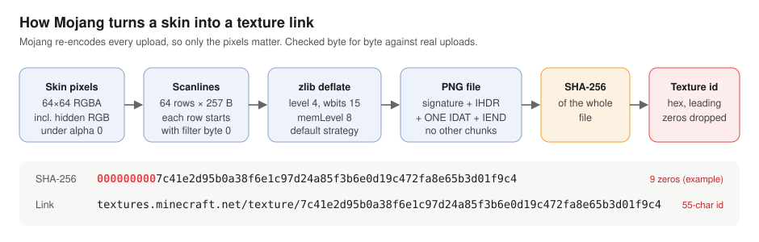
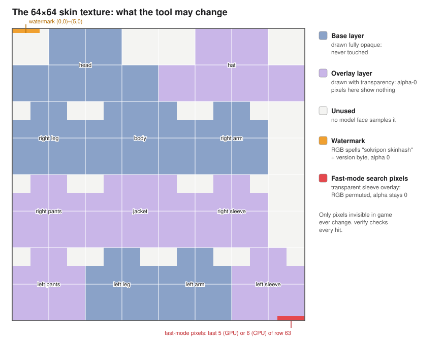
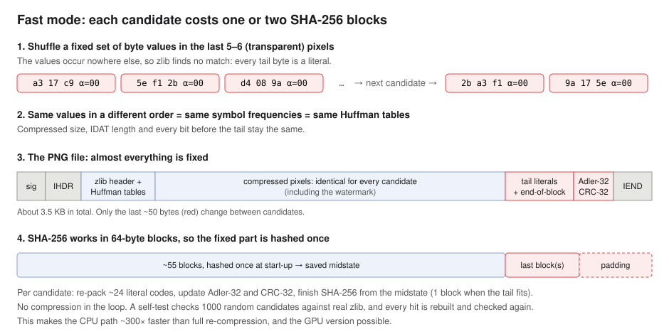
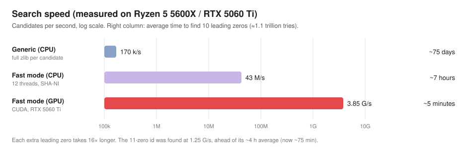

# How skinhash works

## 1. The texture link is a hash of the pixels



When you upload a skin, Mojang decodes it and re-encodes it in one fixed way:

- 64×64 RGBA, every row prefixed with filter byte 0;
- compressed with zlib level 4 into a single IDAT chunk;
- no other chunks.

The texture id is the SHA-256 of that file in hex, without leading zeros. The bytes of the file you upload
don't matter, only the pixels. We confirmed this by predicting the id of a test upload exactly.

Change any pixel and the id changes completely and unpredictably. So finding a "cool" id means trying many
invisible variations until one hashes to something you like: a hex word at the start (`c0ffee…`,
`cafebabe…`), or many leading zeros, which make the link shorter.

## 2. Which pixels may change



| Area | How Minecraft treats it | Used by the tool? |
|---|---|---|
| Base layer (blue) | Drawn fully opaque. The skin loader forces alpha to 255 here, so hidden colours would show. | Never touched |
| Overlay layer (purple) | Drawn with transparency. A pixel with alpha 0 shows nothing, whatever its RGB. | Only pixels that are already fully transparent |
| Unused (grey) | No face of the player model samples it, so it's never drawn. | Watermark, `--unused-only` |

### Pixels changed per mode

| Mode | Pixels changed | Coordinates on the example skin (Steve) |
|---|---|---|
| Watermark (every mode) | 6 unused transparent pixels; RGB spells `sokripon skinhash` + version byte `0x03` | (0, 7)–(5, 7), unused corner of the head layout (v2 used (0, 0)–(5, 0), which Mine Little Pony reads) |
| GPU fast mode (`--engine gpu`, or auto) | the last 5 pixels of the file, as long as they are invisible | (59–63, 63), end of the left sleeve overlay |
| CPU fast mode (`--engine cpu`, or auto without a CUDA build) | the last 6 pixels of the file, as long as they are invisible | (58–63, 63), end of the left sleeve overlay |
| Generic mode (`--engine generic`, or when the last pixels are visible) | a 64-bit counter in the RGB of the last 3 invisible pixels found | (61–63, 63) |
| Generic + `--unused-only` | the same, but only pixels no model face ever samples (also disables fast mode) | (61–63, 51), unused corner next to the left sleeve |

The Mojang search never changes alpha, only the RGB under alpha 0. NameMC mode (section 6) sets alpha 0 → 1 on its pixels.

The tool checks each skin instead of assuming. Fast mode runs only if every one of its pixels is a
transparent overlay pixel or an unused pixel. Otherwise it falls back to generic mode with other invisible
pixels. `--no-generic` stops with the reason instead of falling back to the 300× slower generic search.
`py skinhash.py pixels SKIN` shows which pixels each mode would use on a given skin and whether fast mode is possible.

Before you upload, `verify` re-checks every hit: the file hashes to its name, real zlib reproduces it byte
for byte, and no visible pixel differs from the original skin. A pixel whose alpha went 0 to 1 on an overlay
or unused pixel is accepted as a NameMC knob (any RGB), so `verify` also passes for NameMC and Both results.

No pixel chosen by the tool comes from the set that other mods read as data (Ears marker and palette, Mine
Little Pony triggers, Tails rows, deadmau5 ear box; `RESERVED` in `skinhash.py`, shown in `skin-areas.png`).

### Are the changes really invisible?

| Claim | Status | Evidence |
|---|---|---|
| Mojang's servers keep the hidden RGB unchanged | Proven | Test uploads got exactly the predicted ids. That's only possible if every hidden byte survived. |
| The tool only touches transparent overlay or unused pixels | Checked by code | Selection rules above; `verify` checks every hit. |
| The Java client draws nothing for alpha-0 overlay pixels | Very likely | The skin loader's alpha-forcing only covers base-layer regions, not the sleeve overlay. The overlay is drawn with alpha cutout, and skin textures aren't filtered. Partly transparent overlays with leftover colour are common in real skins. |
| Every other renderer (Bedrock via Geyser, third-party viewers, mods) does the same | Not tested | `--unused-only` avoids the question: those pixels are never drawn at all. |

To check yourself, wear a skin made by the tool, open Options → Skin Customization or press F5, and look at
the end of the left sleeve. Nothing should be visible there.

## 3. Fast mode





Re-compressing the whole skin for every candidate is slow, about 150–170k tries/s. Fast mode skips compression:

1. It fills the search pixels with byte values that occur nowhere else in the image. zlib can't match them
   against earlier data, so they always come out as literals.
2. Each candidate is a reordering of the same values. The symbol frequencies stay the same, so the Huffman
   tables, the compressed size and every bit before the tail are identical for all candidates.
3. Only the last ~50 bytes of the file change: the tail literal codes, the Adler-32 and the CRC-32.
4. SHA-256 works on 64-byte blocks, so the ~55 fixed blocks are hashed once into a saved midstate. A
   candidate only finishes the last block or two.

The result is the file real zlib would produce, built with a few dozen bit operations. A start-up self-test
compares 1000 random candidates against real zlib, and every hit is rebuilt and checked again.

## 4. GPU mode

The CPU prepares a small job once: the fixed file prefix, the SHA-256 midstate, the Huffman codes of the
search values, the Adler/CRC state and 16 test vectors. The GPU hashes candidates from it.

### Rate steps (RTX 5060 Ti)

| Step | Rate |
|---|---|
| First working version (6 pixels, 2 SHA blocks per candidate) | 1.16 G/s |
| 5 pixels instead of 6. The changing bytes plus SHA padding now fit into one 64-byte block, which halves the SHA work. | 1.93 G/s |
| New enumeration. Each GPU thread decodes the first positions of its permutation once with 32-bit maths (no 64-bit divisions), then tries all 24 orderings of the last 4 positions. The bits after the shuffled region are constant, so only a few bytes are patched in. CRC-32 runs word by word, the Adler sum is updated linearly, and the global best-so-far counter is touched once per thread instead of once per candidate. | 3.58 G/s |
| Block-size and occupancy tuning | ~3.85 G/s |

A kernel that only does SHA-256 reaches about 4.46 G/s, so there's little headroom left. The full history,
including what didn't help, is in the [optimization log](optimizations.md).

**Pixel count.** `fastfinder --dump-job --auto` tries pixel counts from 6 downwards, with up to 400 random
value sets each, and picks the largest count whose changing bytes fit one SHA block. On the example skin that is
5; 6 did not fit on the skins we tried. If nothing fits, length tuning (below) is tried, and only after that the best
2-block configuration, at about 2.1 G/s.

**Length tuning.** Whether the changing bytes fit one block depends on the compressed length before them, mod 64.
For some skins (Dinnerbone, Grumm, any skin that already has NameMC alpha-1 pixels) that is a bad number for every
K and value set. Then `--auto` changes the RGB of 1-6 alpha-0 pixels earlier in the image (unused first, never
`RESERVED`, never the watermark or the last row), about 6 bytes of compressed length per pixel, until a one-block
layout with K >= 5 exists. This takes 50-100 tries of about 1 ms each and has worked on every skin tried. The
value set is chosen afterwards, and the tuned image is kept across rollovers. The pixels are invisible, don't
touch the NameMC id, and are listed by the CLI and by `skinhash.py pixels`. `--no-length-tuning` disables it.

### Value-set rollover

5 pixels hold 15 byte values, so one value set has 15! ≈ 1.3 trillion orderings, about 5.6 minutes of GPU
time. Then the search rolls over to a new set:

1. gpufinder covers every ordering of the current set once, prints `ROLLOVER` and exits with code 7.
2. `skinhash.py` builds a new job with a fresh random value set. The GPU passes the correctness check again.
3. The search continues. The `tried=` counter, the rate and benchmarks keep counting across rollovers.

A rollover costs under a second.

### Safety checks

- **Correctness check:** before searching, and after every rollover, the GPU must reproduce all 16
  CPU-computed test vectors exactly. Otherwise it exits with code 5 and `skinhash.py` falls back to the CPU.
- **Hit re-check:** every hit is rebuilt and re-hashed on the CPU before it's reported. `skinhash.py` then
  verifies it again with Python's zlib.
- **Ctrl+C** stops the whole search and never triggers the CPU fallback.

## 5. Speed



| Mode | Option | Rate |
|---|---|---|
| Generic (CPU) | `--engine generic` | ~150–170k/s |
| Fast mode (CPU) | `--engine cpu` | ~45–50M/s |
| Fast mode (GPU) | `--engine gpu` | ~3.85G/s |

Each extra leading zero takes 16× longer on average:

| Target | GPU at 3.85G/s |
|---|---|
| 8-char hex word | ~1 s |
| 9 zeros | ~18 s |
| 10 zeros | ~5 min |
| 11 zeros | ~75 min |
| 12 zeros | ~20 h |

In a ~64M-skin archive the shortest real skin link has 8 leading zeros, so 9 or more is a new record.

Example result, made from `skins/steve.png` in the web page's Both mode and uploaded:

- Mojang: `textures.minecraft.net/texture/7848d1fb944bf2b37a597632fc8e1abbd495a440e3f699b9124165`
  (10 leading zeros, 54-character id)
- NameMC: `namemc.com/skin/00000000001d91b1` (10 leading zeros, shown in the URL)

The served file is byte-identical to the downloaded PNG. It differs from Steve in 15 invisible pixels: the watermark,
3 NameMC pixels (alpha 0 → 1) and 6 Mojang search pixels (hidden RGB under alpha 0).

`pixel-map.svg` is generated from the same layout tables the tool uses: `py docs/make_pixel_map.py`.

## 6. NameMC ids

NameMC identifies a skin by a different hash than Mojang's texture id:

```
id = first 16 hex digits of SHA-256( be32(width) || be32(height) || RGBA pixels, R=G=B=0 where alpha == 0 )
```

It hashes pixels, not the PNG file, so the compression tricks of sections 3 and 4 are not needed. Zeroing RGB
under alpha 0 also means the Mojang knob has no effect on it.

**Knob.** Three pixels get alpha 1 and a varying RGB. A pixel is eligible if it is currently alpha 0 and in
the overlay layer or unused. Base-layer pixels and pixels that already have alpha > 0 are never changed.

| Mode | Pixels on the example skin (Steve) | SHA blocks per candidate |
|---|---|---|
| default | (55, 56, 57; 63), end of the left sleeve overlay, just before the Mojang tail (58-63, 63) | 2 |
| `--unused-only` | (61, 62, 63; 51), unused corner, never sampled by the model | 50 |

At alpha 1/255 the default pixels should be invisible in game, but this has not been checked in game yet.
The unused pixels need no check. The watermark is kept; it is alpha 0 and does not affect the id.

**Search.** The message is 16392 bytes. SHA-256 is resumed from a midstate over the blocks before the first
knob pixel. A 64-bit counter fills the 9 RGB bytes (one pixel is one 32-bit message word). The last block
has the same message for every candidate, so on the GPU its K+W constants are precomputed, and one thread
hashes 1024 counters that differ only in the last pixel, which shares the work before that word.

**Combining with a Mojang id.** The Mojang search changes only RGB under alpha 0 (and the alpha-0
watermark), which NameMC ignores. So: `namemc` first, then `mojang` on the result (the `both` command does exactly this). The alpha-1 pixels are
fixed for `mojang`, and `verify` still passes (also against the original skin). Side effect: the bytes next to the tail often prevent the
one-block layout of GPU fast mode. Length tuning (section 4) restores it, so the Mojang phase of `both` runs at
~3.9 G/s instead of 2.1 G/s.

| Mode | Rate |
|---|---|
| NameMC, CPU, default knob | ~135M/s |
| NameMC, GPU, default knob | ~3.1G/s |
| NameMC, CPU, `--unused-only` | ~6.8M/s |
| NameMC, GPU, `--unused-only` | ~148M/s |

A pure SHA-256 kernel on this GPU does ~4.5G one-block hashes/s, so the 2-block default is near what the
hardware allows.

NameMC's URL shows all 16 digits, leading zeros included (checked with `namemc.com/skin/00000000001d91b1`).
The tool matches on that fixed 16-digit id.

## 7. Browser version

The same search runs in the browser with WebGPU (`web/`, start with `py web/serve.py`):

- **Modes:** Mojang texture link, NameMC skin page, or Both. Both runs the NameMC phase, then the Mojang
  phase on that result. The phases add up instead of multiplying, because the Mojang search only touches
  RGB under alpha 0, which NameMC ignores.
- **Same pipeline:** the job builder, deflate parser and self-test are ported to JavaScript, and pako stands
  in for zlib (byte-identical in 392 test cases). The kernels are WGSL ports of the CUDA finders.
- **Same safety checks:** the GPU must reproduce CPU test vectors before every search. Every hit is
  re-checked on the CPU, both ids and only invisible pixels changed, before it's offered for download.
- **Speed:** about 75–80% of native in Chrome.

The example result in section 5 was made this way.

